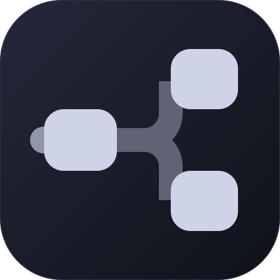

<p align="center">
  
</p>

<h1 align="center">ComfyUI-Arisu-Nodes</h1>

<p align="center">
  <strong>A package of useful ComfyUI nodes optimizing user experience.</strong>
</p>

<p align="center">
  
  
  
  
  <a href="https://github.com/swqa7697/ComfyUI-Arisu-Nodes/actions/workflows/comfyui-lane.yml"></a>
</p>

## Installation

Requires **ComfyUI >= 0.30.0**, **Python >= 3.10**, Pillow, and PyAV in ComfyUI's environment.
Recommend to use with Nodes 2.0 option **disabled**.

### ComfyUI-Manager

Search for **ComfyUI-Arisu-Nodes** in **Manager → Install Custom Nodes**, install it, and restart ComfyUI.

### Manual

Clone the pack into your ComfyUI installation:

```bash
cd ComfyUI/custom_nodes
git clone https://github.com/swqa7697/ComfyUI-Arisu-Nodes.git
```

Ensure Pillow and PyAV are available in ComfyUI's Python environment, then restart ComfyUI.
Find the nodes under **Add Node → Arisu Nodes**.

#### Configuration

The pack creates `user/__arisu_nodes/config.arisu.jsonc` on first startup.
Use this file for the pack's server settings. To add external media directories,
edit `roots` with existing absolute paths (`"D:/Photos"` on Windows), then restart ComfyUI:

```jsonc
{
  // Edit these directories manually, then restart ComfyUI.
  "roots": {
    "photos": "/data/photos",
    "references": "/mnt/library/references"
  },
  // Managed by the Agents settings UI; manual editing is not recommended.
  "workbench": {}
}
```

ComfyUI's `input` and `output` directories are available by default.
Clients can browse these roots and use **Assemble Video → Delete Files…** to delete selected videos wherever the ComfyUI process has filesystem permission.
JSONC supports comments; omit trailing commas.

#### Optional setup

- **Node layers:** open **Settings → Arisu Nodes → Workflow**. **Save Node Layer Order** defaults to off; enable it to record the current overlap order when saving. **Restore Node Layer Order** defaults to on and restores recorded layers when loading, independently of saving. Both options apply to all workflows, including those without Arisu nodes, and cover subgraphs. Turning saving off keeps existing records unchanged. Changing the restore option takes effect on the next load. Layer records travel with the workflow JSON; another installation needs this extension to restore them.
- **Agent generation:** install Docker with Linux container support and give the ComfyUI process access to its daemon.
  Open **Settings → Arisu Nodes → Prompt Workbench → Agents** to build an agent image, sign in,
  and select a model and reasoning effort. Under **Grok Build**, keep **Model default** or choose a supported **Context window (tokens)** for both Workbench nodes. Docker Desktop must use Linux containers on macOS/Windows. Provider accounts and settings are shared by users of the ComfyUI instance.
  If either Workbench reports an outdated image, select the named provider in **Agents** and click **Update CLI**. The update preserves your login.
- **Custom prompt skills:** place each skill folder, including its `SKILL.md` and supporting files, at
  `user/__arisu_nodes/skills/<skill-name>/` under ComfyUI's user directory. The pack creates the `skills`
  directory on startup; administrators manage its contents. Select `custom:<skill-name>` in either Workbench.
  To make a writing skill eligible for automatic Director selection, add a `director.json` beside `SKILL.md`.
  Provide a short `purpose`, a description of its writing `characteristics`, and an `inputs` array listing supported roles from `first`, `last`, `image`, `video`, and `audio`. Use an empty array for text-only writing.

In Prompt Workbench, choose a skill, connect your contexts, and click **Generate prompt**.
For a first clip, turn off **Motion Context → Enable motion context** to keep the wires
connected and generate without waiting for the video queue. Settings and references use
CPU; enabled motion decoding uses the queued GPU with a separate preparation cache.
**Agent time** shows elapsed generation time in the node and Generation results, excluding queueing
and media preparation. Prompt and Director Workbench each allow up to 10 minutes for preparation,
including queue time, followed by up to 60 minutes for agent generation. The final duration stays
available while the workflow remains open.
Open **Generation results**, review the **Output Prompt** tab, and click **Apply to Workbench**
to replace the finalized prompt. Use Undo to restore the previous text. Workflow edits and
switching between open tabs preserve the running job and its result.

Reference videos contribute up to eight stills from the selected clip. With **Motion Context**
enabled, the agent also sees up to ten stills from the previous clip’s final five seconds,
in chronological order. The selected context length sets the H3 prompt timing. Use
**Visual Notes** for details such as camera movement and **Audio Notes** for sounds to carry
forward, including background music. To change those sounds, say so in **Requirements**.
Agents receive audio descriptions as text and are restricted to prompt generation, with
web search, commands, and file editing disabled.

### Direct a multi-segment film

Add **MiniMax H3 Director Workbench** to your graph. Connect its `prompt`, `video_settings`, and `resources` outputs to the matching inputs on **MiniMax H3 Hybrid to Video**. The Director render controls also require the **comfyui-h3-motion-context** pack. See the [Director node guide](web/docs/ArisuMiniMaxH3DirectorWorkbench/en.md) for the render chain.

Open **Film Setup** to write the **Film Requirements** in plain text or Markdown and set the generation length range. Add reference material to the asset library. Use **Plan the film** to draft the whole sequence in one agent task. Director chooses each segment’s length around the action and the visual details needed in the next segment. The film can run shorter or longer than the optional runtime target.

Review the coverage, timing, bindings and prompts, then apply the plan. Click a **Sequence** card to select that segment for rendering. Click **Edit** on a card or **Edit Segment** below the sequence to open the editor, with **Prompt**, **Direction**, **Assets & Skill**, and **Revise Prompt** sections. Edit the film requirements to replan the sequence, or use **Revise Prompt** for a local change. When revising a continuation, Director samples the final seconds of the previous take’s saved video on the CPU, even if its latent was removed. Agent generation uses the same Docker and account settings as Prompt Workbench.

To start a new plan from your film requirements, settings and asset library, choose **Film Setup → Clear all segments** and confirm. This clears the applied plan and discards any pending draft. One Undo restores the applied plan and its render records.

Render the current segment to inspect its footage, or render the remaining segments in order. A continuation loads the previous take and trims its overlap from both picture and sound. Save the workflow to retain the plan and render records. Keep each take’s video and latent together under ComfyUI’s output directory for recovery.

### Save segments and assemble a film

Replace the final **Save Video** of a graph with **Save Video Segment** and give it a project, typed or linked from **Path Builder**. Each run saves a new take under `<project>/videos/`: a playable MP4 in H.264, H.265 or AV1, a take record, and the sound as float PCM. An earlier take is never replaced, so you can render a segment several times and compare. Use `clip_name` for the file name. Director Workbench renders through Save Video Segment into `<project>/director/<take UUID>/clip.mp4`. Its companion folder holds the continuation latent and the segment identity, position and description.

Add **Assemble Video** to the same workflow or to a workflow of its own. Choose project takes by thumbnail, segment and duration, or browse for an existing video. Click a thumbnail to play the footage in a separate preview dialog. **Import from Director** replaces the entire edit with the selected Director’s current rendered takes in film order. If the edit already contains clips, choose **Replace Edit** to confirm. Import again after a rerender to use the new takes. Replace takes, reorder, exclude, and loop each join with sound. **Check Export** shows the frame count, the duration and what happens to each track before anything is written: compatible video is copied without loss, and sound is rebuilt on one continuous sample timeline and encoded once, so picture and sound stay aligned across every join. **Export** writes a new version under `<project>/exports/` with the film and a record of the sources and decisions that made it. Use **Remove Selected** to keep the files on disk or **Delete Files…** to review and confirm deletion. Deleting a Director take removes its entire UUID folder, including the latent. Deleting an ordinary take removes its video and dedicated `.arisu/` folder. See the [Assemble Video guide](web/docs/ArisuAssembleVideo/en.md).

Both nodes use the system `ffmpeg` and `ffprobe` when ComfyUI can find them, which is recommended. Without an `ffmpeg` executable they fall back to the PyAV libraries, log a warning for each job, and always encode.

## Nodes

Click a node name for its full reference, also available through the node's right-click **Help** menu.

### Common

| Node                                                                          | Summary                                                     |
| ----------------------------------------------------------------------------- | ----------------------------------------------------------- |
| [Path Builder](web/docs/ArisuPathBuilder/en.md)                               | Build a filename prefix from separate text fields.          |
| [Extract Last Images](web/docs/ArisuExtractLastImages/en.md)                  | Keep the last N images from a batch.                        |
| [Preview & Save Image](web/docs/ArisuPreviewSaveImage/en.md)                  | Preview images and save them on demand.                     |
| [Preview & Save Image (Upscale)](web/docs/ArisuPreviewSaveImageUpscale/en.md) | Upscale previewed images when saving.                       |
| [Load Image (Browse)](web/docs/ArisuLoadImage/en.md)                          | Browse and crop images from configured directories.         |
| [Resize Image](web/docs/ArisuResizeImage/en.md)                               | Resize and preview images by cropping, padding, fitting, or stretching; runs with unconnected outputs. |
| [Save Video Segment](web/docs/ArisuSaveVideoSegment/en.md)                    | Save a video as a new take with a record and lossless sound for assembly. |
| [Assemble Video](web/docs/ArisuAssembleVideo/en.md)                           | Select takes, check each join, and export a film on an exact frame and sample timeline. |

### MiniMax H3

| Node                                                                                        | Summary                                                                       |
| ------------------------------------------------------------------------------------------- | ----------------------------------------------------------------------------- |
| [MiniMax H3 Model Loader](web/docs/ArisuMiniMaxH3ModelLoader/en.md)                         | Load H3 natively or experimentally replace an inclusive AdaLN block range.    |
| [MiniMax H3 Director Workbench](web/docs/ArisuMiniMaxH3DirectorWorkbench/en.md)             | Plan and render a film as a sequence of individually editable H3 generations. |
| [MiniMax H3 Prompt Workbench](web/docs/ArisuMiniMaxH3PromptWorkbench/en.md)                 | Write prompts or generate and review drafts with Codex or Grok.               |
| [MiniMax H3 Resource Studio](web/docs/ArisuMiniMaxH3ResourceStudio/en.md)                   | Arrange, crop, and trim keyframes and image, video, or audio references.      |
| [MiniMax H3 Hybrid to Video](web/docs/ArisuMiniMaxH3HybridToVideo/en.md)                    | Combine keyframes and media references into H3 conditioning and an AV latent. |
| [MiniMax H3 Hybrid to Video (Advanced)](web/docs/ArisuMiniMaxH3HybridToVideoAdvanced/en.md) | Add upscaled conditioning for two-pass workflows.                             |
| [MiniMax H3 Video Settings](web/docs/ArisuMiniMaxH3VideoSettings/en.md)                     | Set canvas size, aspect ratio, and duration in one bundle.                    |
| [MiniMax H3 Video Settings (Upscale)](web/docs/ArisuMiniMaxH3VideoSettingsUpscale/en.md)    | Include a target size for latent upscaling.                                   |
| [MiniMax H3 Unpack Video Settings](web/docs/ArisuMiniMaxH3UnpackVideoSettings/en.md)       | Extract individual settings, including frame count, from a Director or Video Settings bundle. |
| [MiniMax H3 SelfLift Progressive Sampler](web/docs/ArisuMiniMaxH3SelfLiftProgressiveSampler/en.md) | Run early Euler steps at low resolution, lift the video, and continue sampling video and audio at the target size. |

The **MiniMax H3 SelfLift Progressive Sampler** uses ComfyUI's native H3 upscaler with your selected checkpoint. Connect the Hybrid or Motion Context conditioning output to `conditioning`. Both stages sample at CFG 1.0. Arisu Hybrid keyframes and Motion Context continuations can use pixel-space guidance during the low-resolution steps. The progressive sampler is adapted from [facok/comfyui-SelfLift](https://github.com/facok/comfyui-SelfLift).

See [example workflows](example_workflows) for ready-made graphs and the [changelog](CHANGELOG.md) for release notes.

## License

[GPL-3.0-only](LICENSE).
